<div align="center">

# AI SaaS Template

**面向付费 AI 工具的 Next.js 开源模板：登录、积分、支付、AI 生成和完整的管理后台。**

克隆下来不用任何配置就能跑，再把演示工具换成你的产品。

[](https://github.com/cdt2019/ai-saas-template/actions/workflows/ci.yml)
[](LICENSE)


[English](README.md) · 简体中文

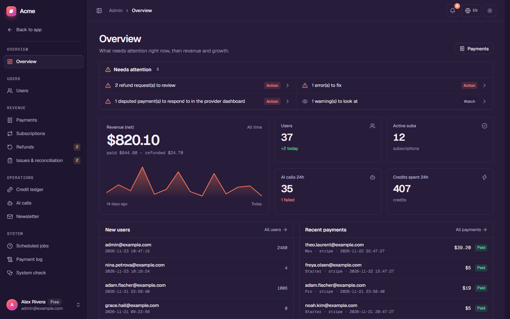

</div>

> 截图里都是虚构的演示数据。「Acme」是占位品牌，在 `src/config/site.ts` 里替换。

## 为什么做这个模板

多数模板做到「能付款」就结束了。AI 产品收费真正麻烦的在后面：回调丢失、伪造回调、积分用掉一部分后退款、扣费后模型调用失败，以及出了问题查不到原因。这个模板专门处理这些情况。

- **不用账号和密钥就能跑。** 内嵌 Postgres、模拟支付、模拟 AI，邮件打印在终端，本地就能走完整个产品。
- **积分可审计。** 每次变动都是一条幂等流水，每天有任务核对余额。
- **支付按「会出错」来设计。** 验签、防重放、主动查漏单、每日对账、退款和拒付都有处理。
- **后台能真正用来运营。** 打开先看今天有什么要人处理，而不是一堆图表。

## 功能

| 模块 | 内容 |
| --- | --- |
| **登录注册** | 邮箱密码 + 6 位邮箱验证码，验证码找回密码，Google、GitHub 登录，基于 Better Auth |
| **防刷** | Cloudflare Turnstile、数据库限流（不需要 Redis）、拦截临时邮箱、防止抢注管理员 |
| **支付** | Stripe、Creem、Waffo 统一接口，另有模拟支付；一次性积分包、订阅、优惠码、试用 |
| **支付可靠性** | 回调验签和幂等、超时、安全重试、主动查漏单、每日对账、乱序事件处理 |
| **积分** | 幂等流水、并发安全扣费、注册赠送、余额不足提醒、退款和拒付按比例扣回 |
| **退款** | 用户自助申请（规则可配置）、提交即冻结积分、管理员审核、按原支付通道退款 |
| **AI** | 流式文本（兼容 OpenAI 接口，默认 OpenRouter）、图片和异步图生视频（fal.ai），先扣费，失败自动退回 |
| **管理后台** | 待处理中心、用户、交易、订阅、退款、异常与对账、积分流水、AI 调用、Newsletter、定时任务、支付日志、系统检查 |
| **定时任务** | 代码注册任务，带锁、超时、运行历史和失败提醒；可由 Vercel Cron、GitHub Actions 或进程内定时器触发 |
| **通知** | 站内铃铛和弹窗、事务邮件（Resend）、多标签页同步积分余额 |
| **Newsletter** | 双重确认、一键退订（RFC 8058）、分批群发、订阅者筛选和 CSV 导出 |
| **文档站** | 内置 MDX 文档：侧栏、搜索、本页目录、上下篇，中英文 |
| **错误监控** | 可选接入 Sentry，覆盖服务端、浏览器、定时任务、支付回调和 AI 失败，发送前去掉个人数据 |
| **产品界面** | 首页、定价、AI 工作台、用户中心、设置、MDX 博客、深浅色主题、响应式 |
| **SEO 与多语言** | 中英文路由、元数据、canonical、hreflang、sitemap、robots、JSON-LD |

## 功能截图

<table>
  <tr>
    <td width="50%"><br><sub><b>首页</b></sub></td>
    <td width="50%">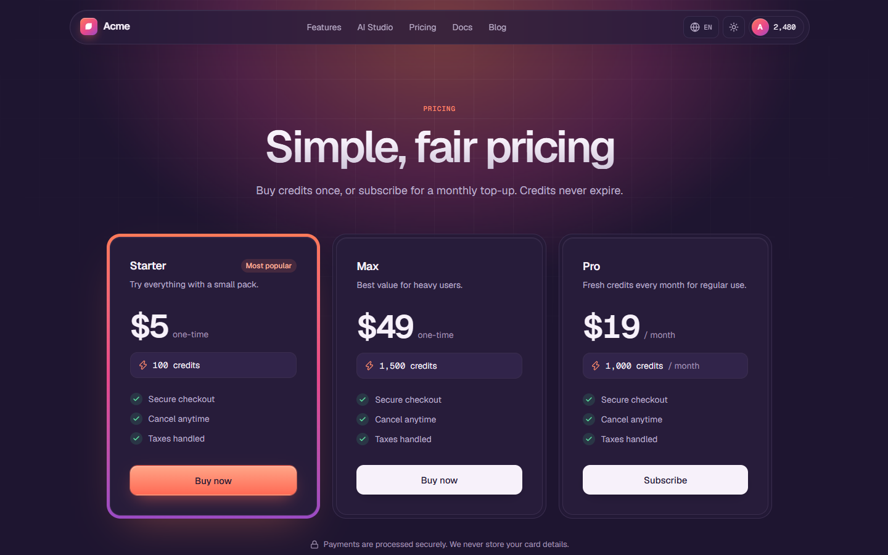<br><sub><b>定价：积分包和订阅</b></sub></td>
  </tr>
  <tr>
    <td>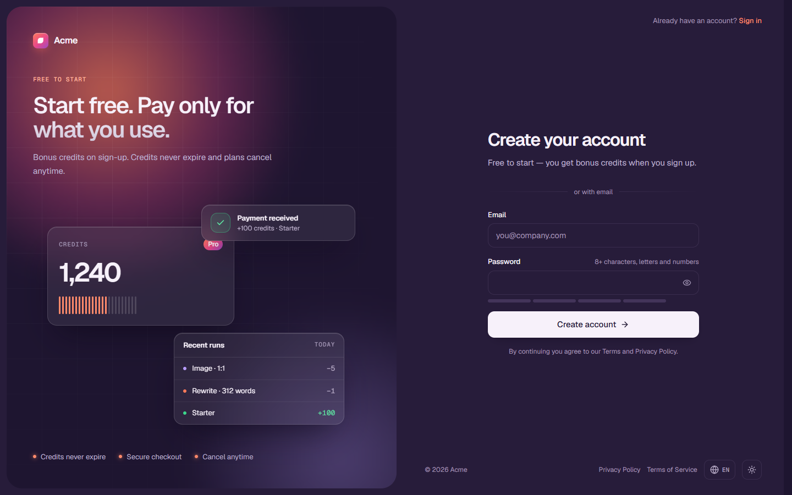<br><sub><b>注册</b></sub></td>
    <td>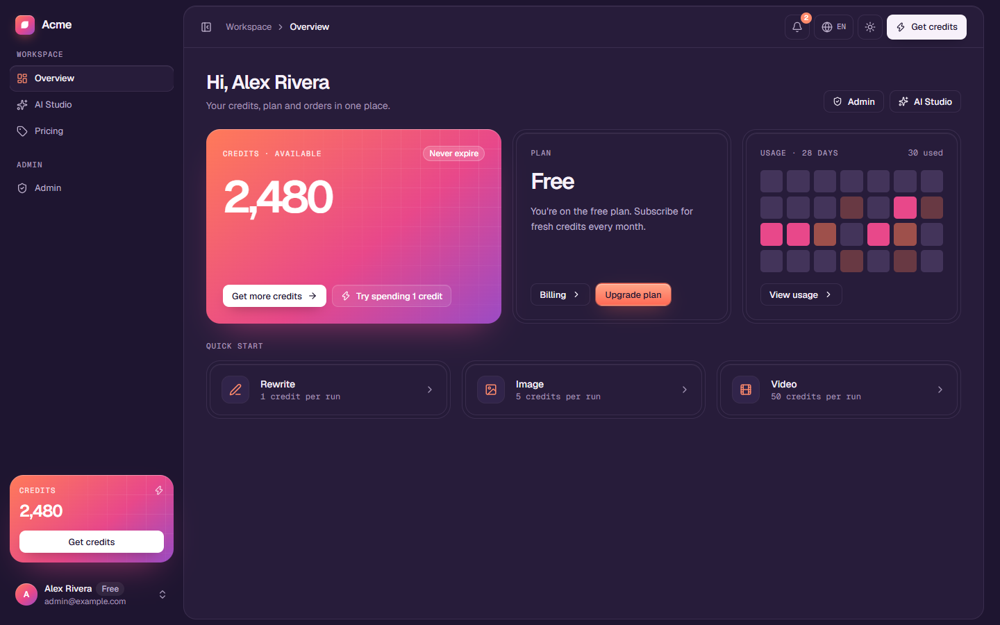<br><sub><b>用户中心</b></sub></td>
  </tr>
  <tr>
    <td>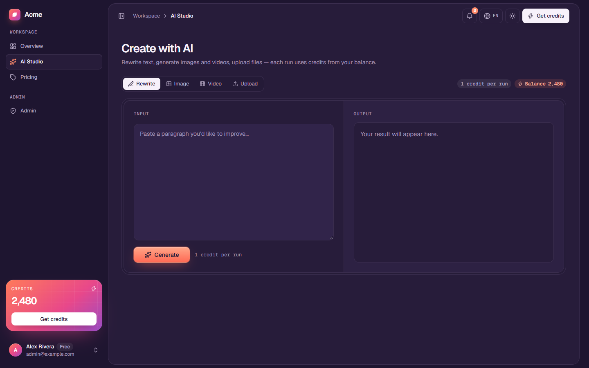<br><sub><b>AI 工作台：文本、图片、视频</b></sub></td>
    <td>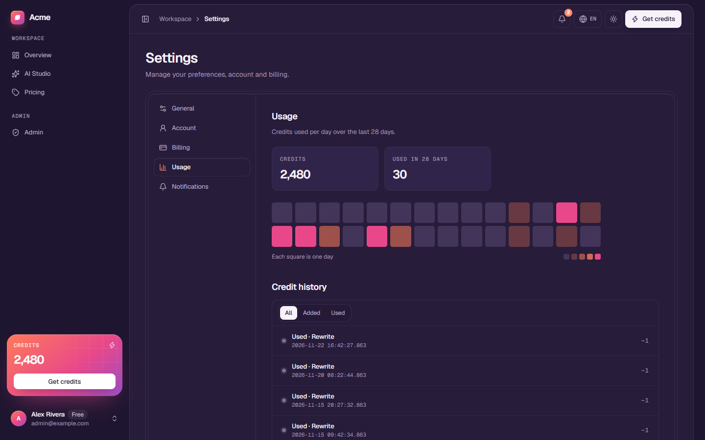<br><sub><b>用量和积分记录</b></sub></td>
  </tr>
  <tr>
    <td>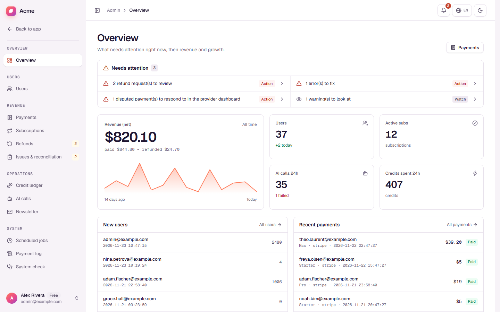<br><sub><b>后台概览（浅色主题）</b></sub></td>
    <td>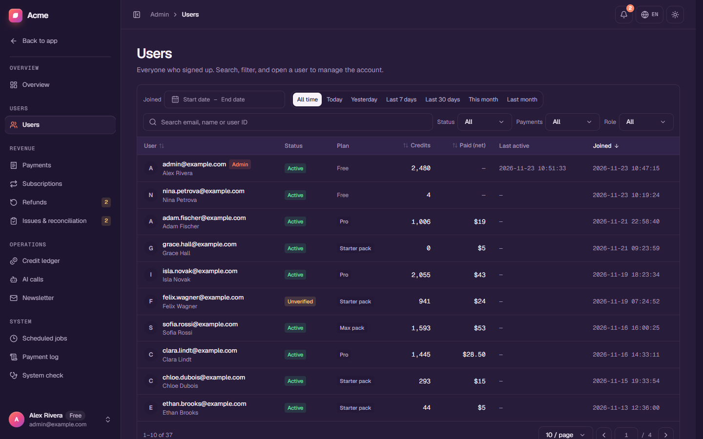<br><sub><b>用户管理</b></sub></td>
  </tr>
  <tr>
    <td>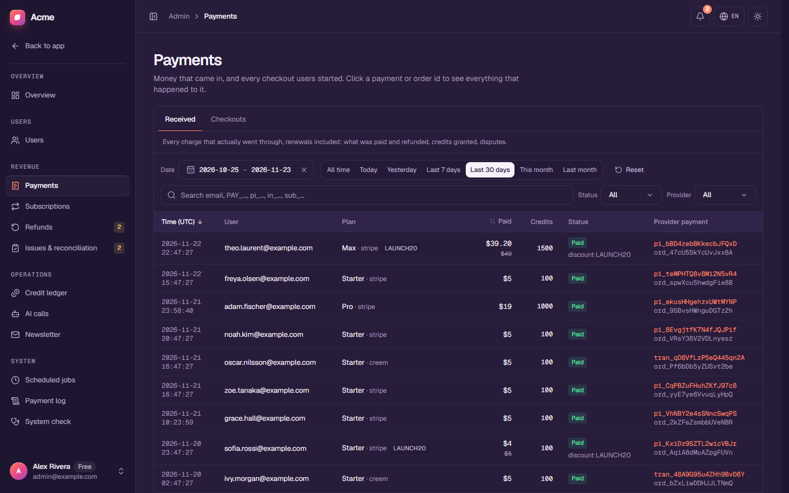<br><sub><b>交易：日期和状态筛选</b></sub></td>
    <td>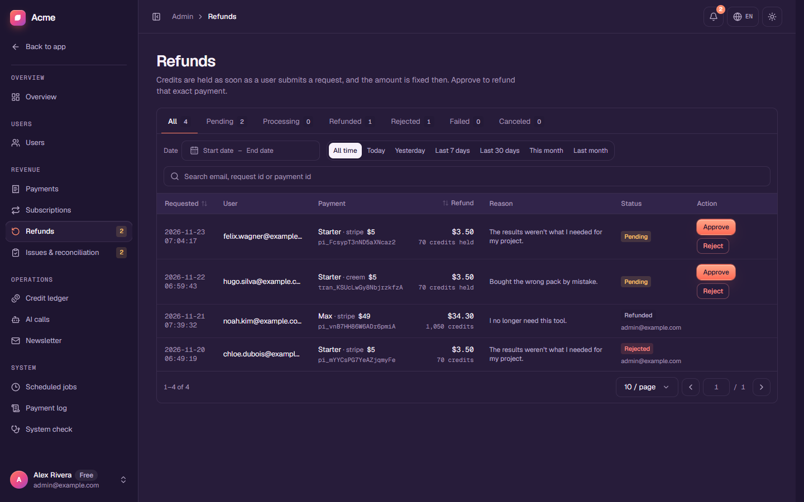<br><sub><b>退款审核</b></sub></td>
  </tr>
  <tr>
    <td>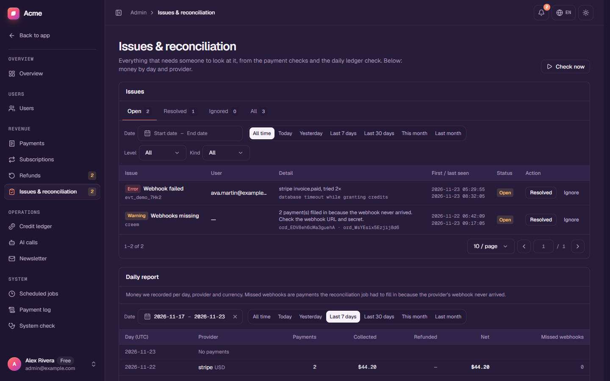<br><sub><b>异常与每日对账</b></sub></td>
    <td>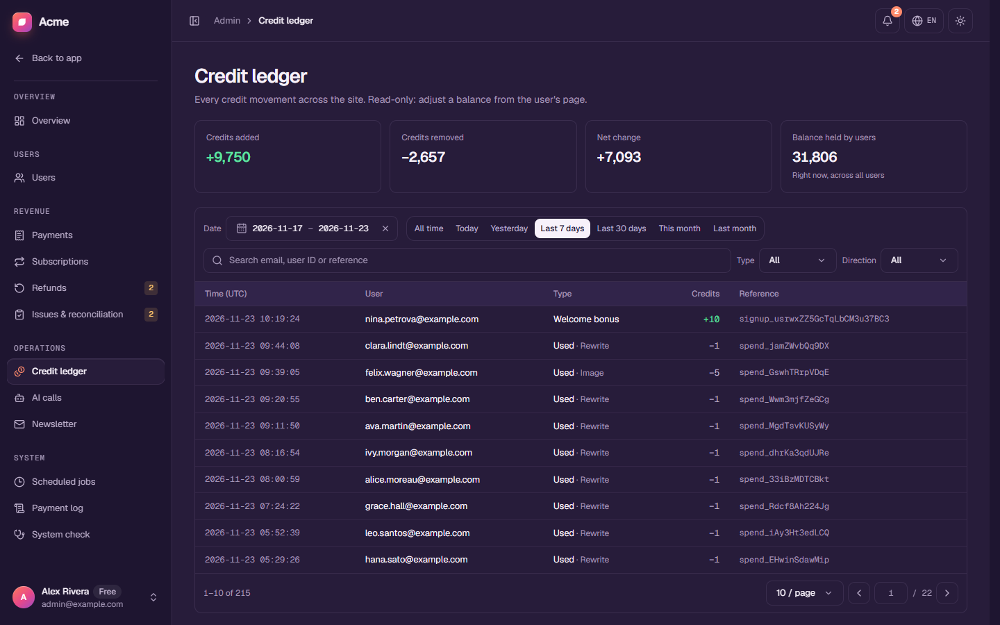<br><sub><b>积分流水</b></sub></td>
  </tr>
  <tr>
    <td>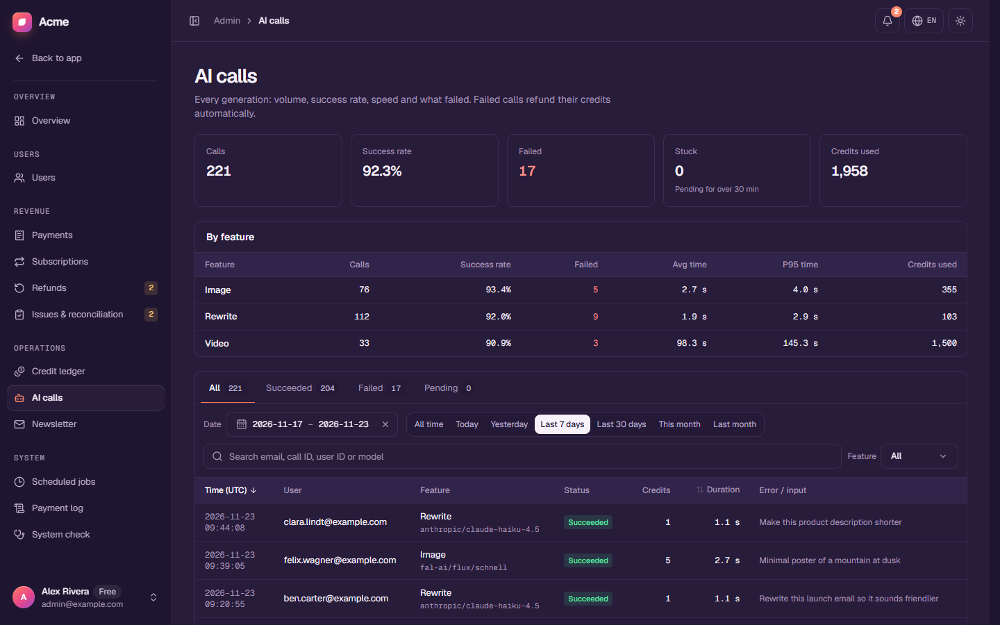<br><sub><b>AI 调用：成功率、耗时、报错</b></sub></td>
    <td>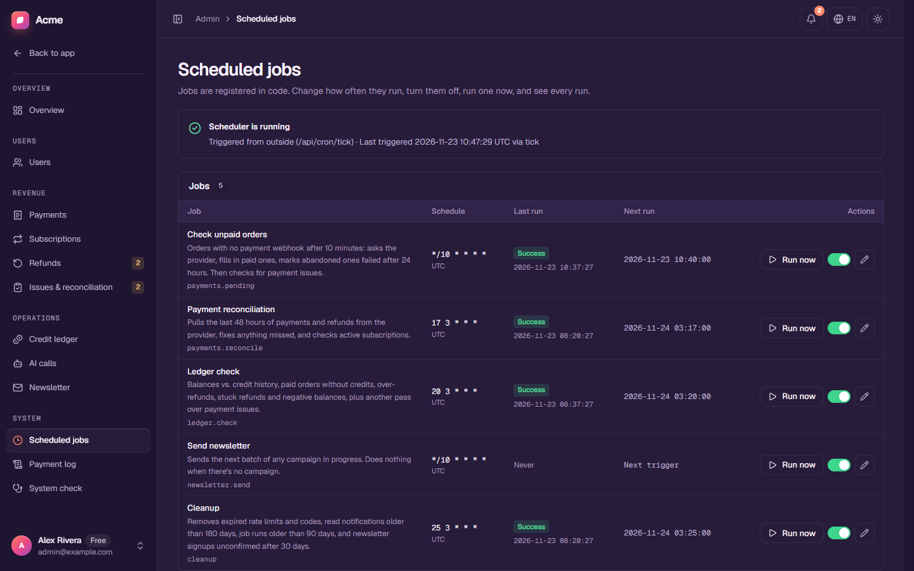<br><sub><b>定时任务</b></sub></td>
  </tr>
  <tr>
    <td>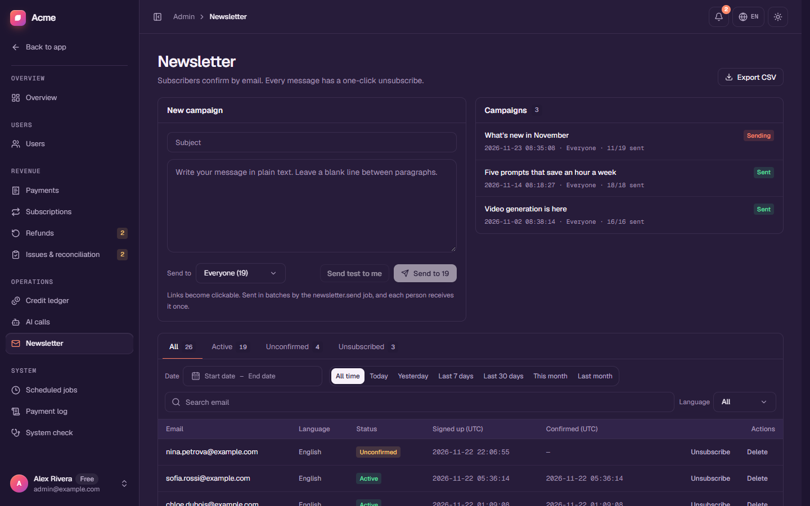<br><sub><b>Newsletter 群发和订阅者</b></sub></td>
    <td>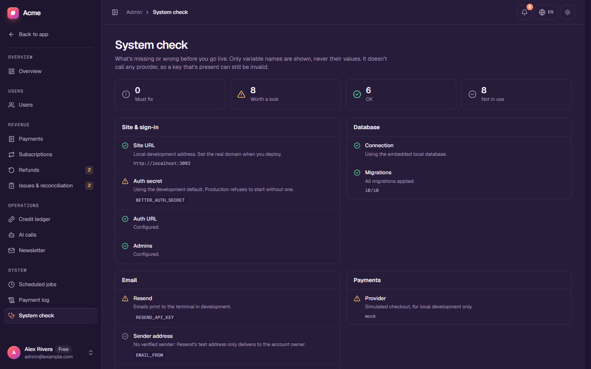<br><sub><b>上线前系统检查</b></sub></td>
  </tr>
  <tr>
    <td>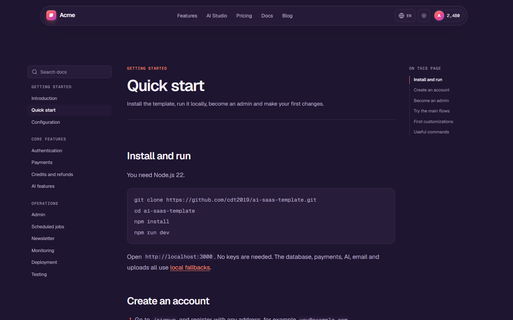<br><sub><b>内置文档站</b></sub></td>
    <td></td>
  </tr>
</table>

## 快速开始

需要 **Node.js 22**。

```bash
git clone https://github.com/cdt2019/ai-saas-template.git
```

```bash
cd ai-saas-template
```

```bash
npm install
```

```bash
npm run dev
```

打开 <http://localhost:3000>。不做任何配置时：

| 服务 | 本地替代 |
| --- | --- |
| 数据库 | PGlite（内嵌 Postgres，存在 `.data/`），启动时自动迁移 |
| 支付 | 模拟收银台，付款后发积分 |
| AI | 模拟结果；提示词里带 `__fail__` 可以测试自动退款 |
| 邮件 | 打印在终端，并写到 `.data/dev-mail/` |
| 上传 | 本地磁盘 |

**进入后台：** 新建 `.env.local` 填上你的邮箱，重启后用这个邮箱注册，输入终端里的验证码：

```bash
ADMIN_EMAILS=you@example.com
```

然后访问 <http://localhost:3000/admin>。

## 技术栈

| 层 | 选型 |
| --- | --- |
| 框架 | Next.js 16（App Router）、React 19、TypeScript |
| 样式 | Tailwind CSS 4、Floating UI、react-day-picker、Lucide |
| 登录 | Better Auth |
| 数据库 | PostgreSQL（Neon、Supabase 或自建）+ Drizzle ORM，本地用 PGlite |
| 支付 | Stripe、Creem、Waffo |
| AI | OpenRouter 或任意 OpenAI 兼容接口、fal.ai |
| 邮件和存储 | Resend、Cloudflare R2 |
| 人机验证 | Cloudflare Turnstile |
| 监控 | Sentry（可选） |
| 测试 | Vitest、端到端脚本 |

## 目录结构

```text
src/
├── app/[lang]/
│   ├── (site)/        首页、定价、文档、博客、Newsletter、法律页面
│   ├── (auth)/        登录、注册、找回密码
│   └── (app)/         用户中心、工作台、设置、后台
├── app/api/           登录、下单、回调、AI、后台、定时任务
├── components/        界面、账户、后台、登录组件
├── config/            站点、价格、AI 功能、退款规则
├── content/           文档和博客（MDX）
├── db/                Drizzle 表结构和连接
├── i18n/              中英文文案
└── lib/
    ├── payments/      支付通道、发货、退款、对账
    ├── ai/            模型调用、扣费、异步视频
    ├── jobs/          调度器、执行器、任务注册
    └── ...            登录、积分、通知、问题表、系统检查
drizzle/               SQL 迁移
tests/                 单元测试（积分、退款、数据脱敏）
scripts/               冒烟和支付端到端测试
docs/                  运维手册和截图
```

## 改成你自己的产品

1. **品牌：** `src/config/site.ts` 改名称、域名、联系方式；`src/app/globals.css` 顶部改颜色；`src/components/Logo.tsx` 改 Logo。
2. **文案：** `src/i18n/dictionaries/en.ts`、`zh.ts`。隐私政策和服务条款请按你的业务审核。
3. **价格：** `src/config/pricing.ts`。
4. **AI 功能：** `src/config/ai.ts` 配模型、积分价格和限制，积分售价建议不低于模型成本的 3 倍。
5. **你的产品：** 替换 `src/app/[lang]/(app)/studio` 和 `src/tool/` 里的演示。

## 部署

可以部署到 Vercel 或任意 Node.js 服务器。

1. 创建 Postgres 数据库，`DATABASE_URL` 用**连接池**地址，`DATABASE_URL_UNPOOLED` 用直连地址。
2. 把 `.env.example` 里用到的变量配到部署平台，至少需要：

   | 变量 | 用途 |
   | --- | --- |
   | `NEXT_PUBLIC_SITE_URL`、`BETTER_AUTH_URL` | 站点地址 |
   | `BETTER_AUTH_SECRET` | `openssl rand -base64 32` |
   | `DATABASE_URL` | 数据库连接 |
   | `RESEND_API_KEY`、`EMAIL_FROM` | 发验证码邮件 |
   | `PAYMENT_PROVIDER` 和对应密钥 | `stripe`、`creem` 或 `waffo` |
   | `CRON_SECRET` | `openssl rand -hex 32` |
   | `ADMIN_EMAILS` | 谁能进 `/admin` |

3. 执行迁移：

   ```bash
   npm run db:migrate
   ```

4. 在支付平台把回调地址配成 `https://你的域名/api/webhooks/<通道>`。
5. 打开 **`/admin/system`**，它会列出没配或不安全的配置、没跑的迁移，以及要填的回调地址。
6. 收真钱之前，先在支付平台沙箱里完整走一遍购买和退款。

项目跑起来后可以在 `/docs` 看文档。各平台配置、定时任务和支付规则见[开发与运维手册](docs/guide.zh-CN.md)。

## 测试

```bash
npm run lint
```

```bash
npm run typecheck
```

```bash
npm test
```

```bash
bash scripts/smoke-test.sh http://localhost:3000
```

`npm test` 用内存 Postgres 测积分账本和退款计算，包括幂等和并发扣费。支付测试跑在本地模拟的支付平台上，不需要任何账号，覆盖发货、订阅、部分和全额退款、拒付、对账，以及伪造回调、重放、抢注管理员等攻击。各通道的运行方式见 [CONTRIBUTING.md](CONTRIBUTING.md)。

## 项目状态

这是一个刚开源的项目，依赖它之前请先了解：

| 部分 | 验证情况 |
| --- | --- |
| 登录、积分、后台、定时任务 | 本地服务器端到端测试 |
| Waffo | 模拟测试 **加** 真实沙箱：购买、订阅、优惠码、试用、退款 |
| Stripe、Creem | 只有模拟测试，还没接过真实接口 |
| OpenRouter、fal.ai、R2 | 只用过 mock，还没用真实 key 跑过 |
| Newsletter | 端到端测试用本地邮件捕获，还没通过 Resend 真实发送 |
| Sentry | 没有 DSN 时不加载，已验证构建；还没接真实项目 |
| 生产环境 | 还没有部署到线上站点 |

上线前请用你自己的平台账号测试你要用的流程。

## 路线图

- [ ] 在沙箱验证 Stripe 和 Creem
- [ ] 验证真实的 AI 和存储服务
- [ ] 验证 Resend 真实发信和 Sentry 上报
- [ ] 第一次生产部署
- [ ] 把代码注释翻译成英文

## 参与贡献

欢迎提 Issue 和 PR，请先读 [CONTRIBUTING.md](CONTRIBUTING.md)。安全问题请按 [SECURITY.md](SECURITY.md) 私下报告。

## 许可证

[MIT](LICENSE)，个人和商业项目都可以使用。软件按现状提供，支付、税务和法律合规由使用者自行负责。
